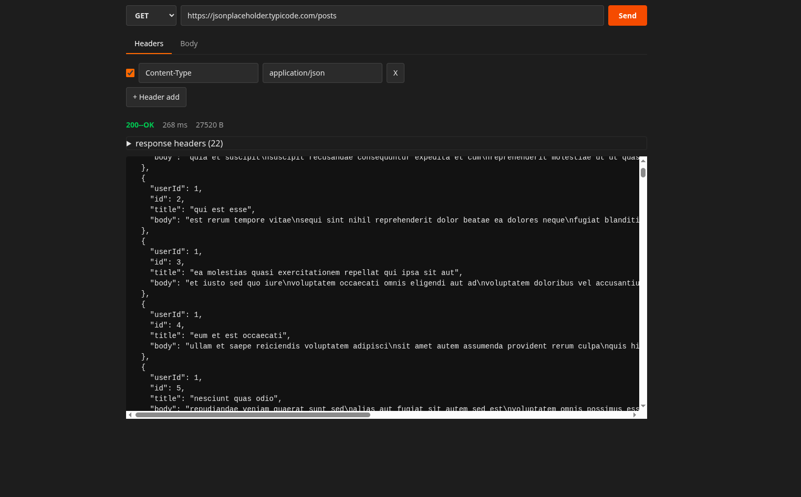

# Lightweight API Client

**Less RAM. More Requests.**

A lightweight API client built for developers who want to send HTTP requests without installing resource-heavy desktop applications.

## Overview

Tools like Postman and Bruno offer powerful API testing capabilities, but running desktop applications can consume considerable system resources.

This project started with a simple idea: **Build a lightweight API client that does the job without unnecessary resource consumption.**

The goal is to provide a fast, simple, and resource-efficient alternative for sending HTTP requests.

The backend is built with **Rust and Actix Web**, while the frontend uses **React, TypeScript, and Vite**.

The application is containerized using Docker. Both the frontend and backend are packaged into a **single Docker image and run inside a single container**, eliminating the need to manage separate frontend and backend containers.

The project is currently under development and supports HTTP requests.

## Screenshots



## Tech Stack

### Frontend

- React 19
- TypeScript
- Vite 8
- Tailwind CSS 4
- ESLint

### Backend

- Rust
- Actix Web
- Reqwest
- Tokio
- Serde / Serde JSON
- Actix Files
- Dotenvy
- Env Logger

### Infrastructure

- Docker
- Multi-stage Docker build
- Debian Bookworm Slim
- Node.js 22 Alpine
- Rust 1 Bookworm

## Architecture

The application uses a multi-stage Docker build to produce a single production image.


### Docker Build Stages

1. **Frontend Build:** Node.js 22 Alpine installs dependencies and builds the React application using Vite.
2. **Backend Build:** Rust compiles the Actix Web backend in release mode.
3. **Production Image:** The compiled Rust binary and frontend build files are copied into a minimal Debian Bookworm Slim image.

### Single Container Deployment

Both frontend and backend run together inside one Docker container.

- React frontend is built into static files.
- Actix Web serves the frontend assets using `actix-files`.
- Actix Web handles API endpoints and HTTP requests.
- No separate frontend container or reverse proxy is required for the basic deployment.

This approach simplifies deployment and keeps the production environment minimal.

## Current Features

- Send HTTP requests
- Rust-powered backend
- React-based user interface
- Single-container Docker deployment
- Multi-stage Docker build
- Lightweight production image

## Roadmap

The project is actively under development. Planned features include:

- [ ] Save and manage HTTP requests
- [ ] Create custom collections and menus
- [ ] Organize requests into folders
- [ ] Support additional HTTP methods and request configurations
- [ ] Request history
- [ ] Environment variables
- [ ] Headers and query parameter management
- [ ] Authentication support
- [ ] Response formatting and visualization

## Getting Started

### Requirements

- Docker

You don't need to install Node.js, Rust, or frontend dependencies on your machine to run the production Docker image.

### Build Docker Image

Clone the repository:

```bash
git clone YOUR_REPOSITORY_URL
cd YOUR_PROJECT_DIRECTORY
```

Build the image:

```bash
docker build -t lightweight-api-client .
```

### Run Container

```bash
docker run -d \
  --name lightweight-api-client \
  -p 8080:8080 \
  lightweight-api-client
```

### Access the Application

Open your browser:

```text
http://localhost:8080
```

That's it! The frontend and backend are both running inside a single Docker container.

### Stop Container

```bash
docker stop lightweight-api-client
```

### Remove Container

```bash
docker rm lightweight-api-client
```

## Environment Variables

| Variable | Default | Description |
|---|---|---|
| PORT | 8080 | Application port |
| DIST_DIR | /app/dist | Frontend build directory |
| RUST_LOG | info | Logging level |

## Project Structure

```text
project/
├── frontend/
│   ├── package.json
│   └── ...
├── backend/
│   ├── Cargo.toml
│   ├── Cargo.lock
│   └── src/
├── docs/
│   └── images/
│       ├── application_screenshot.png
│       └── architecture.png
└── Dockerfile
```

## Why This Project?

The main motivation is to create an alternative to resource-heavy API testing applications.

The project focuses on:

- Minimal resource consumption.
- Fast startup and execution.
- A clean and simple user interface.
- A Rust-powered backend.
- Easy deployment with a single Docker container.
- Essential API testing functionality without unnecessary complexity.

The long